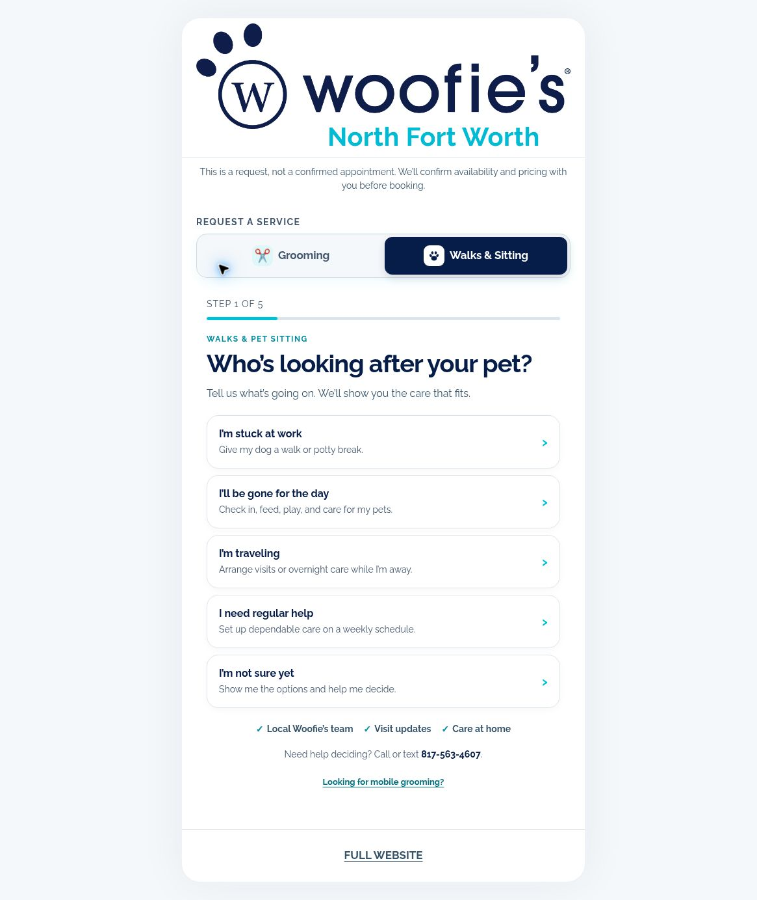

# Jordan Walls

I run Woofie's of North Fort Worth, a mobile pet grooming business, and work full-time as a systems analyst.

I build AI agents and Codex tools that handle real work in the business: lead intake, bookings, visit notes and invoice drafts.

What I've learned: let AI read the messy input, and let code enforce the rules and verify what was saved.

- Live build: [bookyournextgroom.com](https://bookyournextgroom.com), a client booking app built with Codex
- Writing: [@BowTiedHamilton](https://x.com/BowTiedHamilton)

## Selected work

### Guided pet-care requests

[bookyournextgroom.com](https://bookyournextgroom.com) helps customers request grooming, walks, and sitting. Separate service paths, a needs advisor, and multi-pet support turn a general inquiry into a more useful request, while keeping appointment confirmation separate.

[See the walkthrough and design decisions](docs/booking-app-case-study.md)

*Public interface, November 1, 2026.*

### From AI-assisted work to persistent software

I started with individual customer messages, expanded into agent-assisted business workflows, and now use AI coding tools to turn those processes into persistent software. Codex built the server foundation; Cursor built the newer booking implementation. That newer build is in Practice mode with sandbox/sample operating data, not live customer bookings.

[Explore the projects and current status](PROJECTS.md) · [From specification to code](docs/spec-to-code.md)
