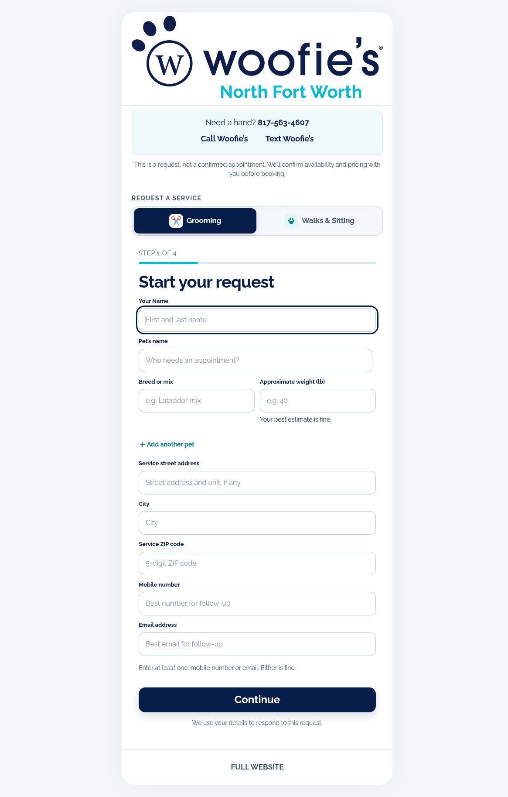
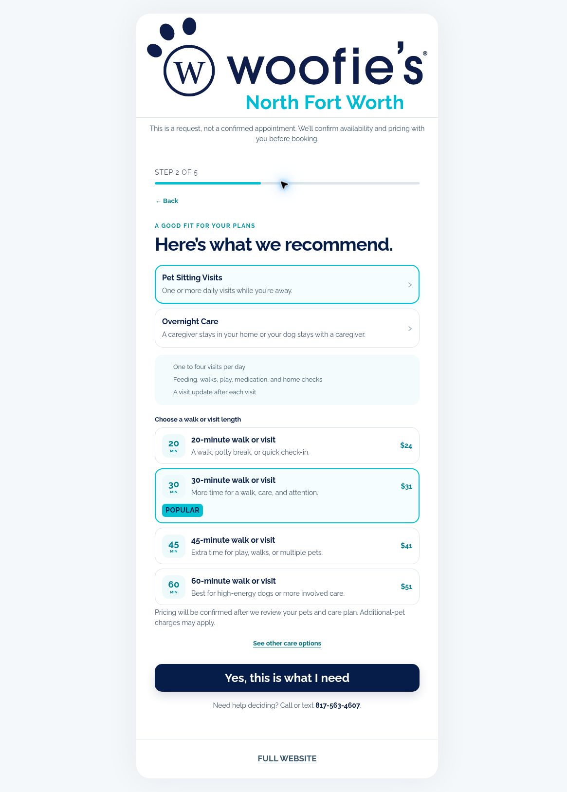

# Helping customers ask for the right pet-care service

**Live site:** [bookyournextgroom.com](https://bookyournextgroom.com)  
**Public interface observed:** November 1, 2026, 20:06 UTC

I run Woofie's of North Fort Worth and built Easy Booking with Codex. A customer may know their dog needs a groom or that they're going out of town without knowing which service to request, what information we need, or what happens after they submit it.

This site gives them a guided way to explain that need. It also makes the handoff clear: they are requesting service, not reserving a confirmed appointment.

## Walk through it

You can explore the public interface without submitting a request: choose **Walks & Sitting**, then **I'm traveling**, and compare the care options. Stop before entering personal details or submitting.

### Grooming



The grooming request uses a four-step flow. It collects details such as breed, weight, and address, and includes an option for multiple pets. Customers can provide a mobile number or email, with call and text shortcuts also available.

Those details put more context into the inquiry than a name and a free-text message alone.

### Walks and sitting



*Public interface captured November 1, 2026. Displayed prices are part of this snapshot; the site says final pricing is confirmed after review.*

The walks/sitting path has a five-step needs advisor. For example, selecting **“I'm traveling”** presents **Pet Sitting Visits** and **Overnight Care**, with explanations of the care included.

The visit options show durations of 20, 30, 45, and 60 minutes. The flow also asks about dates, visits per day, timing windows or flexible timing, and ZIP code. A customer who hasn't settled on dates can say they're not sure yet.

The interaction starts with the customer's situation and helps them understand the available services before completing their request.

## Decisions worth showing

| Visible choice | Why it matters |
| --- | --- |
| Separate grooming and walks/sitting paths | Different services need different questions. |
| A needs advisor for walks/sitting | Customers can start with their situation rather than a service name. |
| Multiple-pet option | A household request can involve more than one pet. |
| Dates-not-sure-yet and flexible timing choices | Customers can express uncertainty instead of supplying a made-up answer. |
| Mobile number or email accepted | Customers have a choice of contact method. |
| Request-versus-confirmation language | Submitting interest should not create a false expectation of a booked appointment. |

## The handoff

```text
Choose grooming or walks/sitting
                  |
                  v
Describe the pets and care needed
                  |
                  v
Provide location, timing, and contact details
                  |
                  v
Submit a service request
                  |
                  v
Availability and pricing confirmed before booking
```

That last distinction matters. The site consistently explains that a request is not a confirmed appointment.

## Try this in your own business

**How hard is it for a customer to request another service from you? If it's hard, do this.**

1. Open your own website on your phone. Start where a returning customer would start and try to request another service.
2. Put one clear request link where customers already look. Use their language: “I'm traveling” is easier to answer than choosing an unfamiliar service name.
3. Ask only for the details you need to respond. Let customers say they're unsure about timing instead of making them invent an answer.
4. Explain what happens after submission, including who confirms availability and when the request becomes an appointment.
5. Ask someone unfamiliar with your business to try the flow. Fix the first point where they hesitate.

You can improve that customer handoff before automating any booking. My site is one example to inspect, not a template that proves the back-office work is finished.

## How this fits into my AI work

I started using ChatGPT to rewrite lead responses and card-on-file explanations, then used ChatGPT Work for full business workflows. Context and rules weren't consistent across runs. That pushed me toward putting the requirements into persistent software using AI coding tools.

Today, Minerva and Atlas take booking requests, and I confirm them. The site helps collect useful information; it does not establish that a booking has been completed.

Tiro is a separate, unfinished booking program. Codex built the server foundation and is now working alongside Cursor on it. As of November 1, 2026, Codex is handling the server-side build and real-model Practice runs; Cursor has added extraction tracing. This work is still in progress.

[See the project history](../PROJECTS.md) · [Read the sanitized spec-to-code excerpt](spec-to-code.md)

> **Current status, November 1, 2026:** the public request site is live. The separate newer booking workflow is in Practice mode, using sandbox/sample operating data rather than live customer bookings. The current work has not yet established a completed end-to-end backend booking.

This walkthrough covers the visible customer experience. It does not claim that submitting the form automatically completes a booking. The operational code and client information stay private.
